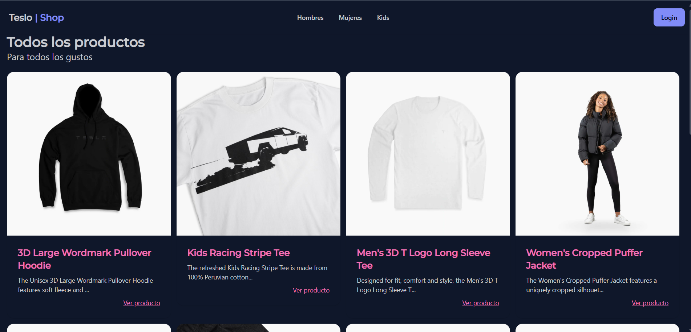
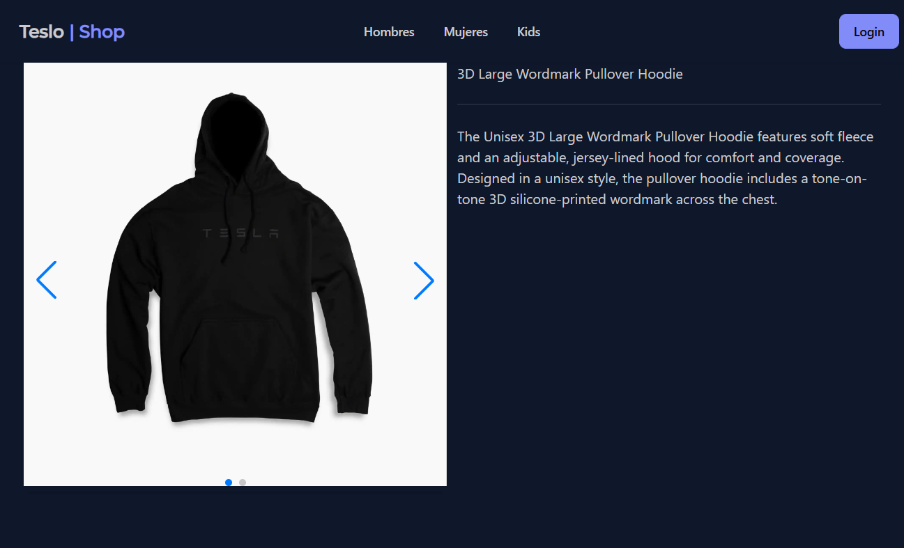
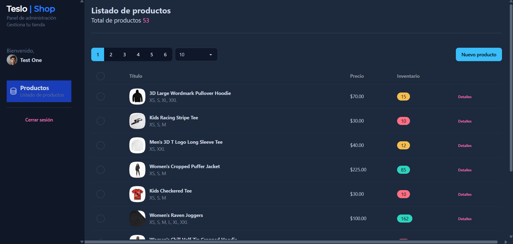

# 🛍️ Teslo - Shop

Aplicación web de comercio electrónico desarrollada con Angular. Permite explorar un catálogo de productos, consultar sus detalles y gestionar productos mediante un panel administrativo. Se integra con una API REST desarrollada con NestJS.

## 🚀 Demo

🌐 **[Ver Teslo - Shop en Netlify](https://teslo-shop-front-web.netlify.app/#/)**

## 🔑 Credenciales de demostración

Puedes registrarte para explorar la tienda como usuario normal o utilizar la cuenta de demostración para probar el panel administrativo.

Administrador
Correo: test1@google.com
Contraseña: Abc123

Cuenta destinada exclusivamente a demostraciones del proyecto. No debe utilizarse para información personal o sensible.

## ✨ Características

### 🛍️ Catálogo de productos
- Visualización del catálogo de productos.
- Exploración de productos por categorías de género.
- Consulta de los detalles de cada producto.
- Navegación entre productos mediante paginación.
- Carrusel de productos relacionados.

### 🔐 Autenticación
- Inicio de sesión y registro de usuarios.
- Formularios reactivos con validaciones.
- Opción para mostrar u ocultar la contraseña.
- Gestión del estado de autenticación.
- Protección de rutas mediante guards.
- Interceptor HTTP para gestionar solicitudes de autenticación.

### ⚙️ Administración de productos
- Visualización de productos en una tabla administrativa.
- Creación de nuevos productos.
- Edición de productos existentes.
- Carga de imágenes para los productos.
- Gestión de tallas, etiquetas, existencias y precios.
- Restricción del acceso administrativo según los roles de usuario.

### 🚀 Arquitectura y funcionalidades técnicas
- Componentes standalone.
- Angular Signals para la gestión reactiva del estado.
- `rxResource` para la carga de datos asíncronos.
- Carga diferida de rutas (*lazy loading*).
- Componentes y servicios reutilizables.
- Integración con una API REST mediante HTTP.
- Caché en memoria para datos de productos.

## 🛠️ Tecnologías utilizadas

| Tecnología | Uso |
|---|---|
| Angular 22 | Framework para el desarrollo del frontend |
| TypeScript | Lenguaje de programación |
| RxJS | Programación reactiva y manejo de operaciones asíncronas |
| Tailwind CSS 4 | Estilos mediante clases de utilidad |
| DaisyUI 5 | Componentes de interfaz y temas |
| Swiper | Carruseles de productos |
| Angular Reactive Forms | Gestión y validación de formularios |
| Angular Router | Navegación y protección de rutas |
| NestJS | Backend y API REST |
| PostgreSQL | Base de datos del backend |

## 📋 Requisitos previos

Antes de ejecutar el proyecto, necesitas tener instalado:

- [Node.js](https://nodejs.org/)
- npm, incluido con Node.js.
- Git.
- Una instancia funcional del backend de Teslo - Shop.

Puedes comprobar las versiones instaladas con los siguientes comandos:

```bash
node -v
npm -v
git --version
```

## 🚀 Instalación y ejecución

### 1. Clonar el repositorio

```bash
git clone https://github.com/AaronJasso12/teslo-shop-angular.git
```

Entra en la carpeta del proyecto:

```bash
cd teslo-shop-angular
```

### 2. Instalar las dependencias

```bash
npm install
```

### 3. Configurar la URL de la API

El proyecto utiliza archivos de entorno para configurar la dirección del backend.

Para el entorno de desarrollo, revisa:

`src/environments/environment.development.ts`

Ejemplo de configuración:

```typescript
export const environment = {
  baseUrl: 'http://localhost:3000/api'
};
```

Asegúrate de que la URL coincida con la dirección y el prefijo de la API de NestJS.

Para producción, revisa el archivo:

`src/environments/environment.ts`

Actualiza `baseUrl` con la URL pública del backend cuando lo despliegues.

**Importante:** no incluyas contraseñas, tokens ni otras credenciales privadas en los archivos que publiques en GitHub.

### 4. Ejecutar el servidor de desarrollo

```bash
npm start
```

Abre la aplicación en tu navegador:

http://localhost:4200/

La aplicación se actualizará automáticamente cuando realices cambios en el código fuente.

## 🏗️ Compilación para producción

Para generar una compilación de producción, ejecuta:

```bash
npm run build
```

Los archivos generados se guardarán dentro del directorio de salida configurado por Angular, normalmente bajo `dist/`.

## 🧪 Pruebas

Para ejecutar las pruebas del proyecto:

```bash
npm test
```

El proyecto utiliza Vitest como herramienta para ejecutar pruebas.

## 📁 Estructura del proyecto

```text
src/
├── app/
│   ├── admin-dashboard/  # Panel administrativo
│   ├── auth/             # Autenticación, guards y servicios
│   ├── products/         # Componentes, interfaces y servicios de productos
│   ├── shared/           # Componentes compartidos y utilidades
│   ├── store-front/      # Páginas, diseños y navegación de la tienda
│   ├── app.config.ts     # Configuración de la aplicación
│   └── app.routes.ts     # Rutas principales
├── environments/         # Configuración de entornos
└── styles.css            # Estilos globales

public/
└── assets/               # Recursos estáticos, imágenes y fuentes
```

## 🔌 Integración con el backend

El frontend se comunica con una API REST desarrollada con NestJS para gestionar la autenticación, consultar productos, administrar el catálogo y realizar operaciones relacionadas con las imágenes.

La base de datos PostgreSQL es utilizada por el backend para almacenar la información de la aplicación.

El backend debe estar disponible para que funcionen las características que dependen de la API.

## 📸 Capturas de pantalla

### 🏠 Página principal

Catálogo de productos con navegación por categorías y tarjetas de productos.



### 👕 Detalle del producto

Vista detallada con galería de imágenes, nombre y descripción del producto.



### ⚙️ Panel de administración

Interfaz administrativa para consultar el catálogo, visualizar precios y existencias, y acceder a las opciones de gestión de productos.



## 🎯 Objetivo del proyecto

Este proyecto tiene como objetivo practicar el desarrollo de aplicaciones web modernas con Angular, aplicando componentes standalone, Signals, formularios reactivos, protección de rutas, servicios reutilizables e integración con una API REST.

## 👨‍💻 Autor

Proyecto desarrollado con fines de aprendizaje y práctica de desarrollo frontend con Angular e integración con NestJS.
